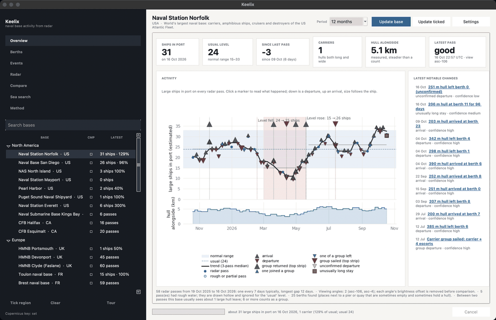
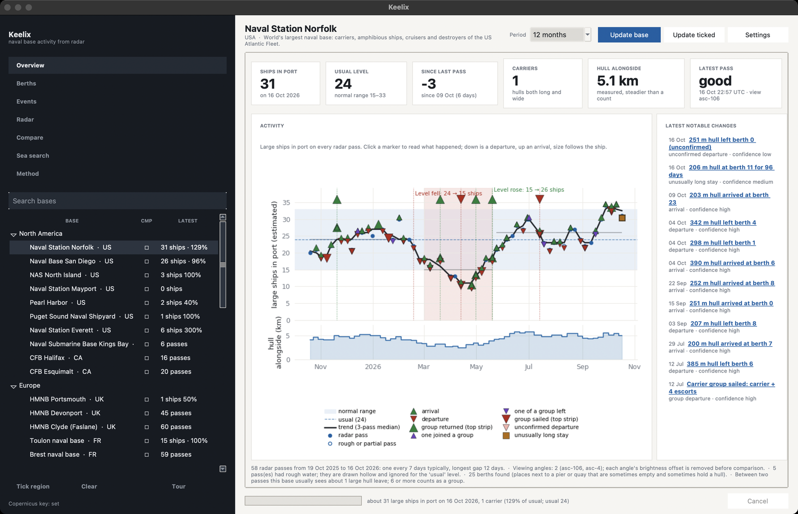
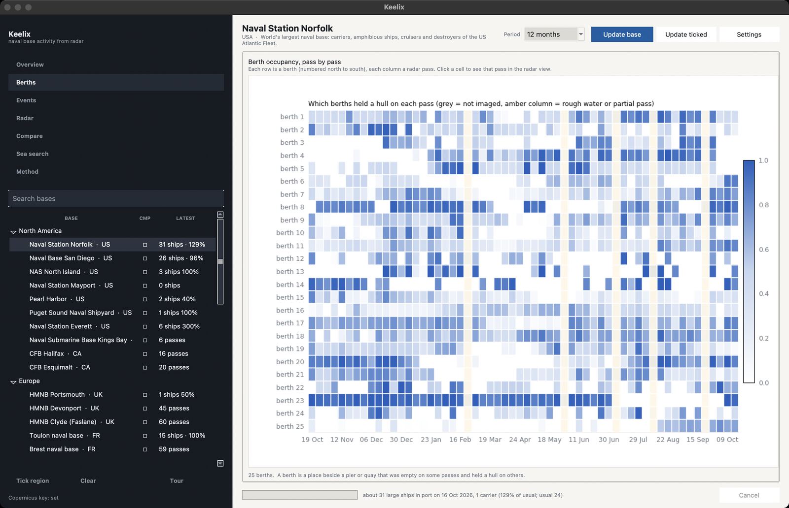
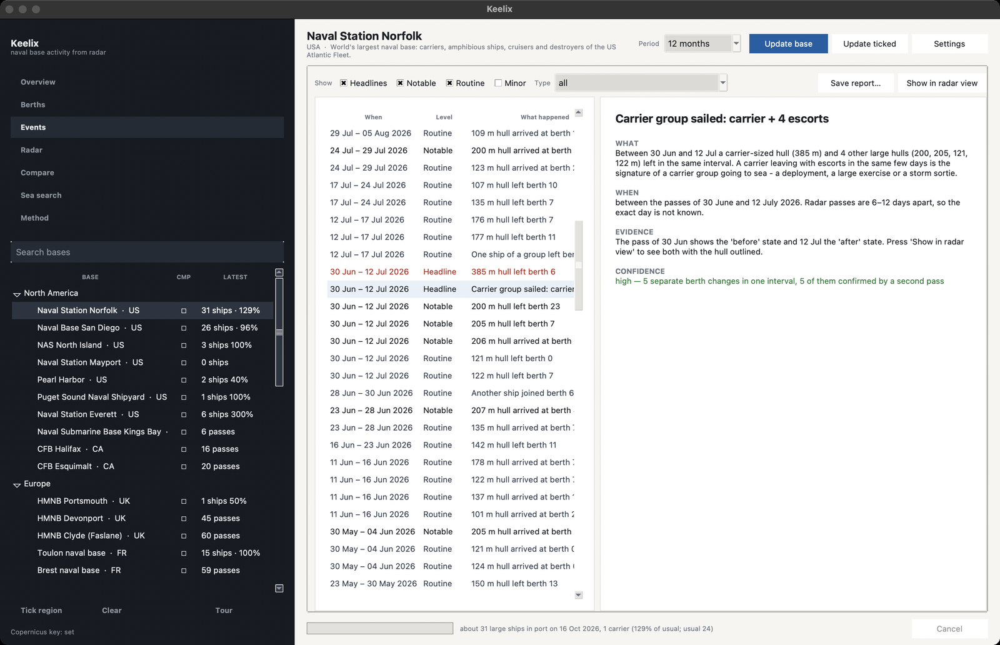
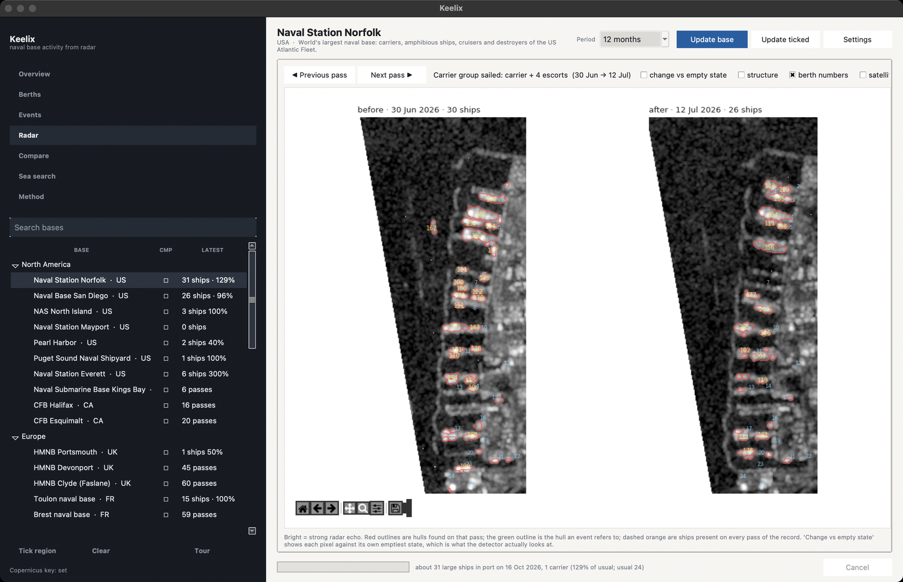
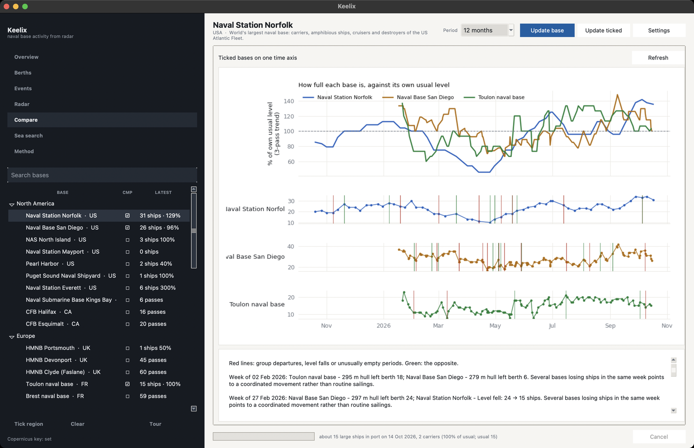
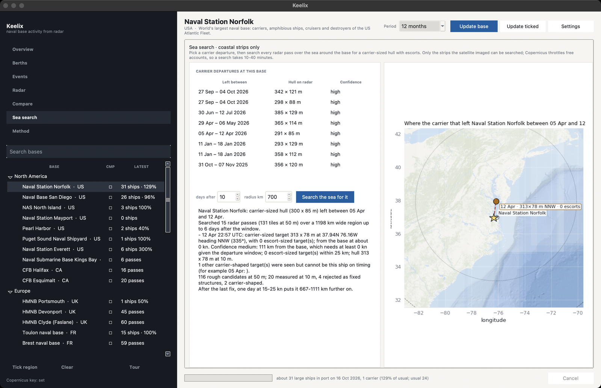
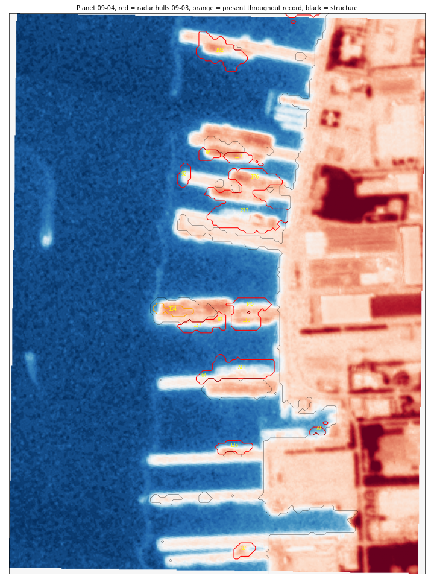

<p align="center">
  
</p>

<h1 align="center">Keelix</h1>

<p align="center">
  A remote-sensing research project: port activity from free Sentinel-1 radar.<br>
  How busy a harbour is, which berths are occupied, and how that changes over time, explained in plain language, with the radar image behind every result.
</p>

<p align="center">
  <a href="#install">Install</a> ·
  <a href="#what-it-shows">What it shows</a> ·
  <a href="#how-it-works">How it works</a> ·
  <a href="#measured-accuracy">Measured accuracy</a> ·
  <a href="#honest-limits">Limits</a> ·
  <a href="#purpose-and-responsible-use">Purpose</a>
</p>

---

Keelix is a study in what free, open satellite data can tell us about activity in harbours. It uses [Sentinel-1](https://dataspace.copernicus.eu/), the European Space Agency's radar satellite, which images each location every 6–12 days from the same angle, through cloud and at night. Steel hulls are bright on radar and water is dark, so with enough passes the program can learn what each berth looks like when empty, notice when it is occupied, and build a timeline of how busy the harbour has been.

It comes with 45 preset harbours, including several large naval ports, because they offer long, well-documented records to test the method against. Any coastal location can be added.

It uses no AIS data and no neural network. Everything is classical signal processing, calibrated against photographs, and every threshold in the code notes which measurement it came from.

## Install

```bash
git clone https://github.com/sparkyniner/keelix.git
cd keelix
pip install -e .
python -m navsim
```

Python 3.10+. On first start a short tour walks through every view.

**Your free key.** Register at [dataspace.copernicus.eu](https://dataspace.copernicus.eu/), open *Sentinel Hub → User settings → OAuth clients*, create a client, and paste its id and secret into **Settings**. It is stored in your user profile: `~/.config/navsim/credentials.json` on macOS and Linux (readable only by you), `%LOCALAPPDATA%\navsim\credentials.json` on Windows. You can also set `CDSE_CLIENT_ID` and `CDSE_CLIENT_SECRET` as environment variables instead. Twelve months of radar for a location takes one to three minutes the first time; after that it opens instantly and offline.

## What it shows

<table>
<tr>
<td width="50%"></td>
<td width="50%"></td>
</tr>
<tr>
<td valign="top"><b>Overview.</b> Vessels in port on the latest pass, the usual level, the change since the previous pass, total length of hull alongside, and the quality of the latest image. The chart shows every radar pass: the band is the normal range, the black line the trend, red triangles departures, green arrivals; shaded periods are unusually quiet or busy.</td>
<td valign="top"><b>Berths.</b> The raw material. Each row is a berth beside a pier or quay, each column a radar pass, the colour how much of the berth held a hull. Click a cell to open that pass in the radar view.</td>
</tr>
<tr>
<td></td>
<td></td>
</tr>
<tr>
<td valign="top"><b>Events.</b> Arrivals, departures, shifts in the overall level and unusually long stays, filterable by type. Each has a short explanation: what changed, between which passes, the size reading, and how confident the result is and why.</td>
<td valign="top"><b>Radar.</b> The image behind any result: before and after side by side, with detected hulls outlined. "Change vs empty state" shows exactly what the detector looks at, so every result can be checked by eye.</td>
</tr>
<tr>
<td></td>
<td></td>
</tr>
<tr>
<td valign="top"><b>Compare.</b> Several harbours on one time axis, each as a percentage of its own usual level.</td>
<td valign="top"><b>Sea search (experimental).</b> Scans radar strips near the coast for very large vessels after a departure. It mostly shows how little of the sea is actually imaged: coasts and straits are covered, open ocean is not.</td>
</tr>
</table>

As an example, twelve months at Norfolk (the test case used for validation) show a steady level through the winter, a quieter period from late February to mid May, and several vessels that stayed at their berths for months.

## How it works

**Finding ships.** Water beside a pier is never dark on radar: the pier's own echo lifts it 5–12 dB even when the berth is empty, so nothing is compared with open water. For every 10 m pixel the program learns the emptiest it has ever looked across all passes (the 3rd percentile), after removing each viewing angle's overall offset and each pass's overall gain. A ship is a stretch at least 6 dB above its own emptiest state, with a core at least 10 dB above it and a peak of at least 18 dB over open water. The faint halo around each bright core is given to the nearest core, so two ships at one pier stay two ships.

**Where a ship can float.** Radar cannot tell a moored ship from a stack of shipping containers: measured over a year of passes at two ports, the two are indistinguishable on every radar feature (median brightness 13.2 vs 13.4 dB, emptiest state 1.4 vs 0.7 dB). Elevation models cannot settle it either, because reclaimed terminals read as 0 m in every free model and are mapped as sea. Keelix therefore uses [ESA WorldCover](https://esa-worldcover.org/), a free 10 m global land-cover map with an explicit permanent-water class, and requires a detection to overlap mapped water. On the test pair this keeps 100% of Norfolk's real ships and removes 63% of a container yard's blocks, with no change to the Norfolk accuracy figures below. WorldCover is a 2021 product, so land reclaimed after that will still read as water; the app says so when no land-cover map is available.

**Berths and structure.** A berth is a place beside a pier or quay that was empty on some passes and held a hull on others. Piers, quays, cranes and land are *structure*: bright even at their emptiest, never counted as ships. A ship that never left during the record looks like structure too; where such a stretch is as bright as a hull (≥18 dB; piers are 9–15) and shaped like one, it is reported as *present throughout*.

**Reading sizes.** Radar length is accurate to about 10–15%, so size readings are broad categories, never identifications. Shape helps: a very large, wide hull reads differently from two smaller ships moored bow to stern (long but narrow) or side by side (short but wide).

**Anomalies.**
- *Level periods* — the ships-in-port series is cut into periods of steady level by exact optimal partitioning (every set of cuts is scored; the cost is each period's spread around its median, with a penalty per cut scaled to the series' own noise). A fall from 24 to 15 that holds for twelve passes is a level shift; one odd pass is not.
- *Group movements* — more berths changing between two passes than this harbour normally sees.
- *Long stays* — a ship at a berth for twice the typical stay at that berth.
- *Quality gate* — a pass that finds a third of the hulls its neighbours find is treated as a bad image, not an empty harbour.
- *Confidence* — every event says what it rests on: "seen on 7 passes, then the berth imaged empty on 2".

## Measured accuracy

Every threshold was set against PlanetScope photographs of Norfolk taken within hours of a radar pass (four clear same-day pairs, 60 ships):

| | hull recall | hull precision | berth-occupancy correlation |
|---|---|---|---|
| first version, thresholds against open water | 0.21 | 0.41 | 0.10 |
| **this version** | **0.65** | **0.95** | **0.73** |

Ship counts per pass agreed with the photos to within one or two ships. Remaining misses are ships that never moved in the record, small or low-echo craft, and ships that moved during the hours between photo and radar. This is a spot check on one location, not a full accuracy study; the other presets ran cleanly but have not been checked against photographs.

<p align="center">
  <br>
  <sub>Radar hulls from 3 September (red) on the Planet photograph of 4 September. Black: piers and structure. Orange: a ship present on every pass.</sub>
</p>

## Honest limits

- It cannot identify a specific ship or tell similar vessel types apart.
- Ships moored side by side or end to end merge; the ship count is an estimate (metres of hull alongside is the steadier number).
- Anything that arrives and leaves between two passes is never seen; dates are only known to the gap between passes.
- A ship that never leaves looks like structure unless it is hull-bright.
- Low-lying vessels echo weakly. Outside the US the free elevation data is coarser.
- Counts depend on the land-cover map being right. Land reclaimed after 2021 is still mapped as water, so a terminal built since then can inflate counts.
- The sea search can only look where the satellite looked: coasts and straits, not the open ocean. It is slow (10–40 minutes) and experimental.

## Purpose and responsible use

Keelix is an educational and research project about what open satellite data can and cannot show. Everything it uses is public: Sentinel-1 radar is free to anyone under the Copernicus open-data licence, and its results are coarse (10 m pixels, a picture every week or so) and delayed. It cannot identify ships or track anything in real time, and it is not intended to. If you build on it, please keep to the same spirit: public data, honest limits, and results that can be checked.

## Command line

```bash
navsim bases                         # list the preset locations
navsim update norfolk --months 12    # download new passes and analyse
navsim report norfolk                # the full timeline as text
navsim compare norfolk san_diego     # several locations on one timeline
navsim setup                         # store the Copernicus key
```

## Layout

| path | what |
|---|---|
| `navsim/app.py` | the desktop app and first-run tour |
| `navsim/charts.py` | every chart, one visual language |
| `navsim/monitor.py` | detection, tracking, events, explanations |
| `navsim/pursuit.py` | the experimental sea search |
| `navsim/radar.py` | Sentinel-1 search, download and cache |
| `navsim/store.py` | per-location download, cache, land mask |
| `navsim/landcover.py` | where a ship can float, from ESA WorldCover |
| `navsim/bases.py` | the preset locations |
| `tests/` | 44 tests on synthetic radar with known truth |
| `attic/` | the earlier PlanetScope pipeline, kept for reference, unused |

Data lives in `~/navsim_data/`; deleting it only means downloading again.

Radar: Copernicus Sentinel-1. Land cover: ESA WorldCover. Land and depth: NOAA global elevation mosaic. Reference imagery in the radar view: Esri World Imagery. MIT licence.
